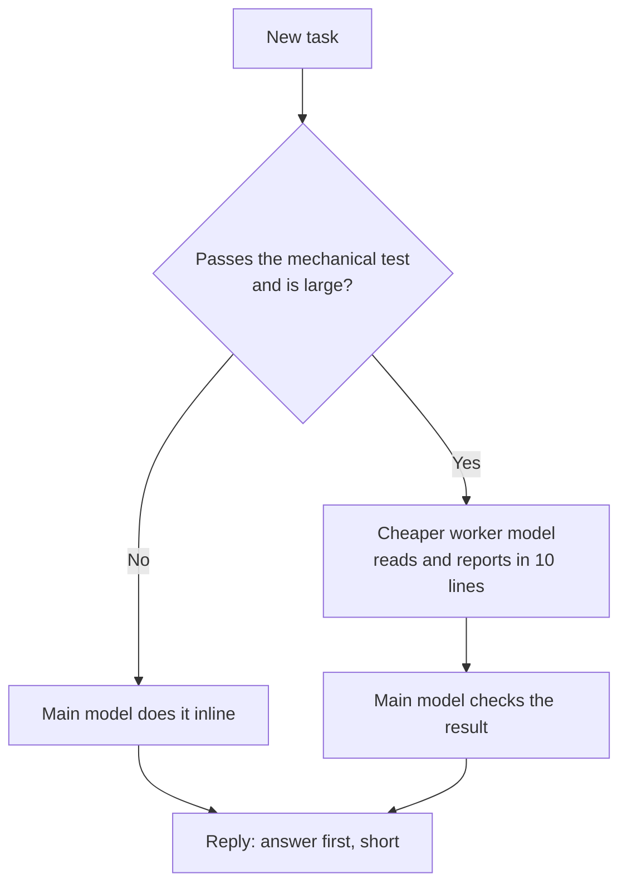
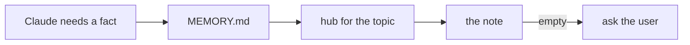

# How it works, in plain language

## What a skill is

A skill is a folder with one instruction file, `SKILL.md`. Claude reads the short description at the top of every skill it has. When your request matches a description, Claude opens the full file and follows it. Nothing runs in the background; the skill is just instructions that Claude reads when they are relevant.

## token-lean: two jobs

**1. Better advice.** Many assistants agree first and think later. This skill tells Claude to open with the most useful thing instead: the answer, a concern, or a question you had not considered. It also asks Claude to mark how sure it is (`[Certain]`, `[Likely]`, `[Guessing]`), to give a reason and an alternative when it disagrees, and to keep its position unless you bring a new fact. Prefer a gentler voice? Say "softer"; the concerns stay, the wording relaxes.

**2. Fewer wasted tokens.** Tokens are what you spend with every message. Five things burn them: using a large model for small jobs, resending a long conversation every turn, long answers, extra files loaded into every session, and the cost of starting a helper from scratch. The skill gives Claude habits for each:

- **Pick the right worker.** Think of a senior who plans and a junior who copies files. A task goes to the cheaper model only if it passes a three-question test: the right result can be described in advance, it needs no taste or judgement, and a mistake is cheap to spot.
- **Delegate only big jobs.** A helper starts knowing nothing, so handing off a small task costs more than doing it. Delegation is for large reading or search jobs, not single lookups.
- **Keep the conversation small.** Search first, read only the needed lines, trim command output, never re-read a file.
- **Hand off before a session gets long.** Around 30 messages, Claude writes a short summary so you can start fresh.
- **Answer first and keep it short**, without ever shortening a warning, a number, or an error message.

## memory-map: a filing cabinet

Claude forgets between sessions. memory-map keeps notes as files and gives Claude one route to follow, like a filing cabinet:

1. **The index card** (`MEMORY.md`): a short page that lists the drawers.
2. **The drawer label** (a hub): one table per topic, one row per note.
3. **The folder** (a note): one fact, or the history of one project.

Before asking you something you may have said before, Claude opens the index, then the one matching drawer, then the one note. When work finishes, Claude adds a line to that project's history: what was done, by whom, when, where the result lives, and what is still open.

The memory is plain text files. To let other devices or chat apps read it, put the folder inside a synced folder (Drive, OneDrive, Dropbox, iCloud) that they can reach through a connector.

## What it does not do

It does not run scripts, change your settings, or contact any server. It cannot force Claude to follow it; it only makes the right behaviour the easy one. See [LIMITATIONS.md](LIMITATIONS.md) for the honest list.
